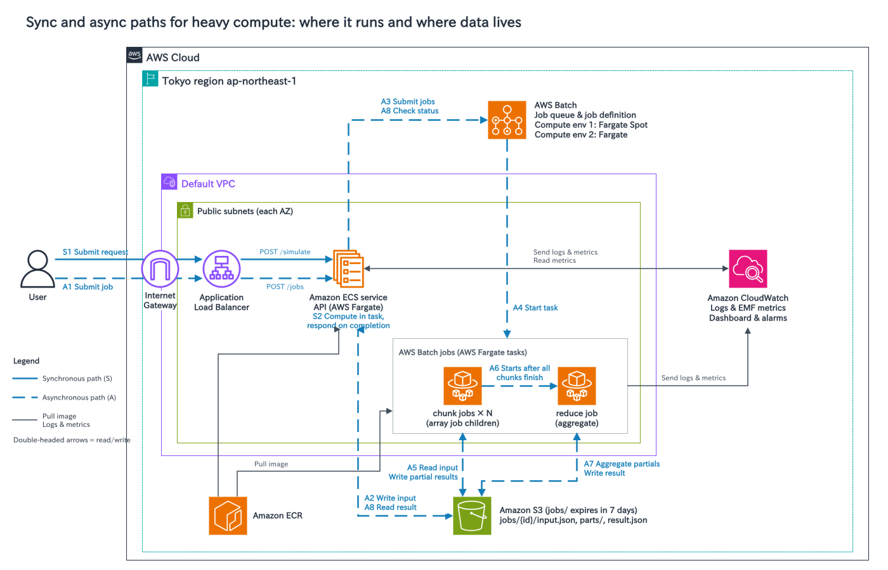

# async-compute-demo

[日本語](README.md)

A demo that moves a heavy computation (NumPy / pandas) out of an API server and runs it in parallel as asynchronous jobs.
It builds FastAPI, AWS Batch on Fargate, Amazon S3, and Amazon CloudWatch with Terraform.

The example workload is a Monte Carlo simulation of a portfolio loss distribution that produces VaR / CVaR.
I chose it as an example of a computation that uses a lot of CPU and memory and can be split up and run in parallel.

## Architecture

The editable source is `docs/architecture-en.drawio`.



S1-S2 are the synchronous path, where the computation finishes inside the API task. A1-A8 are the asynchronous path. The API puts the input in S3 and submits a job (A2, A3), the child jobs of an array job compute in parallel and put intermediate results in S3 (A5), and when all of them finish, an aggregation job puts the result in S3 (A6, A7).

| Endpoint | Role |
| --- | --- |
| `GET /` | UI. Runs sync and async at the same time and shows parallel progress, whether the results match, and CloudWatch numbers on one screen (colors and components follow the values of [GitHub Primer](https://primer.style/)) |
| `POST /simulate` | Reproduces the as-is. Computes inside the API server and does not respond until it finishes. Limited to 1 request at a time (429 if exceeded) and to a workload of up to 100,000 paths × 250 days × 20 assets (422 if exceeded) |
| `POST /jobs` | The to-be. Puts the input in S3, submits a job, and immediately returns 202 with a job ID |
| `GET /jobs/{id}` | Status check. Returns the parallel breakdown (counts of waiting, running, and finished) and, if finished, the result |
| `GET /metrics` | For the charts in the UI. On AWS it reads from CloudWatch with GetMetricData |

There are 4 key points.

- **Separate the API layer from the compute layer.** The API does not compute, so a small task is enough and it scales with the number of requests. The compute layer runs zero tasks when there are no jobs.
- **Communicate only through S3.** Input, intermediate results, and results are all placed in S3, so the API and the compute layer know nothing about each other. Even if you replace the compute layer with ECS RunTask, the only change on the API side is the submission part (`app/backends.py`).
- **Splitting does not change the result.** Random numbers are determined per block, so the result is the same whatever the degree of parallelism (verified in `tests/test_compute.py`).
- **Build measurement into the code.** The worker logs processing time and peak memory as CloudWatch metrics (Embedded Metric Format). An alarm fires when usage exceeds 80% of the job definition's memory limit.

## Run locally

You can try the same flow without AWS. It uses a local directory instead of S3 and a process pool instead of Batch.

```bash
python -m venv .venv && . .venv/bin/activate
pip install -r requirements.txt pytest httpx
pytest -q

uvicorn app.api:app --port 8000
# Open http://localhost:8000/ in a browser to see the UI
# In another terminal
curl -s -X POST localhost:8000/simulate -H 'content-type: application/json' -d '{"n_paths":100000}'
curl -s -X POST localhost:8000/jobs     -H 'content-type: application/json' -d '{"n_paths":100000,"chunks":4}'
curl -s localhost:8000/jobs/<job_id>
```

Results on a 4-core machine (100,000 paths × 250 days × 20 assets).

| Method | Time to respond | Result |
| --- | ---: | --- |
| `POST /simulate` (computed inside the API) | 8.7 s | VaR99 = 0.125645 |
| `POST /jobs` (4 in parallel) | Submission is immediate, 2.8 s to result | VaR99 = 0.125645 (same) |

Results measured on AWS (Tokyo Region, API task 0.5 vCPU, workers 1 vCPU / 2GB, Fargate Spot) on 2026-11-08, 250 days × 20 assets.

| Method | Paths | Parallelism | Response | Time to result |
| --- | ---: | ---: | --- | ---: |
| `POST /simulate` | 20,000 | 1 | Waits until the computation finishes | 4.6 s |
| `POST /simulate` | 100,000 | 1 | Waits until the computation finishes | 20.3 s |
| `POST /jobs` | 100,000 | 4 / 8 | 202 in 0.2-0.3 s | 80 s |
| `POST /jobs` | 1,000,000 | 8 | 202 in 0.2-0.3 s | 98 s |
| `POST /jobs` | 2,000,000 | 16 | 202 in 0.2-0.3 s | 92 s |

- The VaR99 for 100,000 paths was 0.1256448805378465 in all three cases: `/simulate`, 4 in parallel, and 8 in parallel.
- For small computations, `/jobs` is slower. Starting a worker (preparing the Fargate task) takes about 1 minute. 1,000,000 paths and above is a size that `/simulate` does not accept, and with `/jobs` the time to result barely changes even when the number of paths is 20 times larger.
- Where to draw the line between sync and async depends on whether the workload is large enough that parallelism pays off even after paying the startup wait.

## Analyze performance

```bash
python -m bench.benchmark --profile
```

Runs each implementation in a separate process and measures processing time and peak memory. With `--profile`, the slow implementation is run under cProfile.
Results for 20,000 paths on a 4-core machine.

| Implementation | Parallelism | Processing time (s) | vs. slow implementation | Peak memory (MB) |
| --- | ---: | ---: | ---: | ---: |
| naive (pandas, 1 path at a time) | 1 | 3.38 | 1.0x | 76 |
| vectorized (NumPy, 1,000 paths at a time) | 1 | 1.77 | 1.9x | 151 |
| vectorized | 2 | 1.08 | 3.1x | 134 |
| vectorized | 4 | 0.59 | 5.7x | 134 |

Three things can be read from this.

1. In cProfile, about 60% of the slow implementation's time was in pandas `+` and `prod`. Computing in bulk with NumPy makes it about 2 times faster.
2. The rest is random number generation, which is hard to shrink further in a single process. Beyond this point, parallelization is what reduces it.
3. Computing in bulk increases memory. The amount of random numbers expanded at once (`SUB_BATCH_BYTES` in `app/compute.py`, 40MB by default) balances speed and memory. For inputs with many days or assets, the number of paths expanded at once is reduced automatically. The worker's memory limit is decided from these measured values.

## Deploy to AWS

Prerequisites: Terraform 1.6 or later, AWS credentials, Docker. It uses the default VPC.

```bash
cd terraform
terraform init
terraform apply -target=aws_ecr_repository.app   # First create the place for the image

REPO=$(terraform output -raw ecr_repository_url)
aws ecr get-login-password | docker login --username AWS --password-stdin ${REPO%/*}
docker build --platform linux/amd64 -t $REPO:latest ..
docker push $REPO:latest

terraform apply
curl -s -X POST $(terraform output -raw api_url)/jobs -H 'content-type: application/json' \
  -d '{"n_paths":2000000,"chunks":16}'
```

You can change the parallelism and the worker size with variables (`batch_max_vcpus`, `worker_vcpu`, `worker_memory_mib`).
To clean up, run `terraform destroy`.

| File | Contents |
| --- | --- |
| `api.tf` | ECS cluster, ALB, API service, autoscaling by request count |
| `batch.tf` | Compute environment that prefers Fargate Spot, job queue, job definition (retries only on Spot interruption) |
| `storage.tf` | S3 (auto-deleted after 7 days), ECR, log group |
| `iam.tf` | Execution role, least-privilege permissions for the API and the worker separately |
| `monitoring.tf` | Dashboard (API p50/p99, worker processing time and memory, total job time) and alarms |

## What to change for production

These are the points omitted because this is a demo.

- Use private subnets and VPC endpoints (S3, ECR, CloudWatch Logs)
- Store the Terraform state in S3 (noted as a comment in `versions.tf`)
- Keep job state in Amazon DynamoDB and use it for per-customer (tenant) listings and billing
- Make the ALB HTTPS and add authentication
- If computations are short and jobs are few, you can also choose a design where AWS Step Functions calls ECS RunTask instead of using Batch
