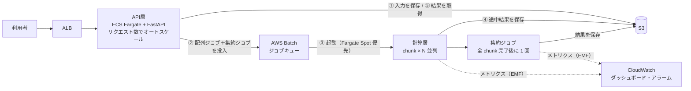

# async-compute-demo

API サーバーの中で動いている重い計算（NumPy / pandas）を、非同期ジョブに切り出して並列化するデモです。
FastAPI、AWS Batch on Fargate、S3、CloudWatch を Terraform で構築します。

計算の題材は、モンテカルロ法でポートフォリオの損失分布を求めて VaR / CVaR を出す処理です。
CPU とメモリをよく使い、分割して並列にできる計算の例として選んでいます。

## 構成



| エンドポイント | 役割 |
| --- | --- |
| `POST /simulate` | As-is の再現。API サーバーの中で計算し、終わるまで応答しない。同時に 1 件まで（超えたら 429）、計算量は 10 万パス × 250 日 × 20 資産まで（超えたら 422） |
| `POST /jobs` | To-be。入力を S3 に置いてジョブを投入し、すぐ 202 とジョブ ID を返す |
| `GET /jobs/{id}` | 状態確認。終わっていれば結果を返す |

ポイントは次の 4 つです。

- **API 層と計算層を分ける。** API は計算しないので小さいタスクで足り、リクエスト数でスケールします。計算層はジョブがなければ 0 台です。
- **S3 だけを介してやり取りする。** 入力・途中結果・結果を S3 に置くので、API と計算層は互いを知りません。計算層を ECS RunTask に替えても API 側の変更は投入部分だけです（`app/backends.py`）。
- **分割しても結果が変わらない。** 乱数をブロック単位で決めているので、並列数を変えても同じ結果になります（`tests/test_compute.py` で確認）。
- **計測をコードに入れておく。** ワーカーは処理時間とピークメモリを CloudWatch のメトリクスとしてログに出します（Embedded Metric Format）。ジョブ定義のメモリ上限の 80% を超えるとアラームが鳴ります。

## ローカルで動かす

AWS なしで同じ流れを試せます。S3 の代わりにローカルのディレクトリ、Batch の代わりにプロセスプールを使います。

```bash
python -m venv .venv && . .venv/bin/activate
pip install -r requirements.txt pytest httpx
pytest -q

uvicorn app.api:app --port 8000
# 別のターミナルで
curl -s -X POST localhost:8000/simulate -H 'content-type: application/json' -d '{"n_paths":100000}'
curl -s -X POST localhost:8000/jobs     -H 'content-type: application/json' -d '{"n_paths":100000,"chunks":4}'
curl -s localhost:8000/jobs/<job_id>
```

4 コアの環境で試した結果です（10 万パス × 250 日 × 20 資産）。

| 方式 | 応答までの時間 | 結果 |
| --- | ---: | --- |
| `POST /simulate`（API 内で計算） | 8.7 秒 | VaR99 = 0.125645 |
| `POST /jobs`（4 並列） | 投入は即時、結果まで 2.8 秒 | VaR99 = 0.125645（同じ） |

## 性能を分析する

```bash
python -m bench.benchmark --profile
```

各実装を別プロセスで動かして、処理時間とピークメモリを測ります。`--profile` で遅い実装を cProfile にかけます。
4 コアの環境で 2 万パスを計算した結果です。

| 実装 | 並列数 | 処理時間 (秒) | 遅い実装比 | ピークメモリ (MB) |
| --- | ---: | ---: | ---: | ---: |
| naive（pandas で 1 パスずつ） | 1 | 3.38 | 1.0x | 76 |
| vectorized（NumPy で 1,000 パスずつ） | 1 | 1.77 | 1.9x | 151 |
| vectorized | 2 | 1.08 | 3.1x | 134 |
| vectorized | 4 | 0.59 | 5.7x | 134 |

読み取れることは次の 3 つです。

1. cProfile では、遅い実装の時間の約 6 割が pandas の `+` と `prod` でした。NumPy でまとめて計算すると約 2 倍速くなります。
2. 残りは乱数生成で、1 プロセスではこれ以上縮みにくい部分です。ここから先は並列化で縮めます。
3. まとめて計算する分、メモリは増えます。一度に展開する乱数の量（`app/compute.py` の `SUB_BATCH_BYTES`、既定 40MB）で、速さとメモリの釣り合いを調整できます。日数や資産数が多い入力では、一度に展開するパス数が自動で減ります。ワーカーのメモリ上限はこの実測値から決めます。

## AWS に構築する

前提：Terraform 1.6 以上、AWS の認証情報、Docker。デフォルト VPC を使います。

```bash
cd terraform
terraform init
terraform apply -target=aws_ecr_repository.app   # 先にイメージの置き場所を作る

REPO=$(terraform output -raw ecr_repository_url)
aws ecr get-login-password | docker login --username AWS --password-stdin ${REPO%/*}
docker build --platform linux/amd64 -t $REPO:latest ..
docker push $REPO:latest

terraform apply
curl -s -X POST $(terraform output -raw api_url)/jobs -H 'content-type: application/json' \
  -d '{"n_paths":2000000,"chunks":16}'
```

並列数とワーカーのサイズは変数で変えられます（`batch_max_vcpus`、`worker_vcpu`、`worker_memory_mib`）。
片付けは `terraform destroy` です。

| ファイル | 中身 |
| --- | --- |
| `api.tf` | ECS クラスター、ALB、API サービス、リクエスト数によるオートスケール |
| `batch.tf` | Fargate Spot 優先の計算環境、ジョブキュー、ジョブ定義（Spot 中断時だけリトライ） |
| `storage.tf` | S3（7 日で自動削除）、ECR、ロググループ |
| `iam.tf` | 実行ロール、API とワーカーそれぞれの最小権限 |
| `monitoring.tf` | ダッシュボード（API の p50/p99、ワーカーの処理時間とメモリ、ジョブ全体の時間）とアラーム |

## 実運用に向けて変えるところ

デモなので省いている点です。

- プライベートサブネットと VPC エンドポイント（S3、ECR、CloudWatch Logs）にする
- Terraform の state を S3 に置く（`versions.tf` にコメントで記載）
- ジョブの状態を DynamoDB に持ち、顧客（テナント）ごとの一覧や課金に使う
- ALB を HTTPS にして認証を入れる
- 計算時間が短くジョブ数が少ないなら、Batch ではなく Step Functions から ECS RunTask を呼ぶ構成も選べる
